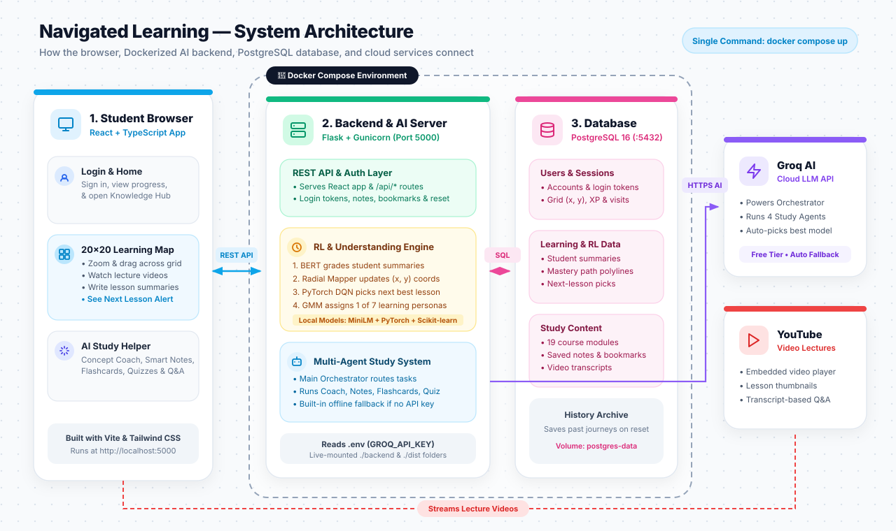

# Navigated Learning (NL) — Platform Documentation

Welcome to the technical documentation for **Navigated Learning**, an AI-powered, Reinforcement Learning (RL) and Multi-Agent adaptive learning platform for Natural Language Processing (NLP) and Large Language Models (LLMs).

---

## Table of Contents

1. [What Is Navigated Learning?](#1-what-is-navigated-learning)
2. [How the Learning Loop Works](#2-how-the-learning-loop-works)
3. [Full System Architecture](#3-full-system-architecture)
4. [Multi-Agent & RL Architecture](#4-multi-agent--rl-architecture)
5. [Core AI & Algorithmic Engines](#5-core-ai--algorithmic-engines)
6. [Database Design (PostgreSQL)](#6-database-design-postgresql)
7. [REST API Reference](#7-rest-api-reference)
8. [Frontend & User Interface Guide](#8-frontend--user-interface-guide)
9. [Quick Start & Docker Deployment](#9-quick-start--docker-deployment)
10. [Project Structure](#10-project-structure)

---

## 1. What Is Navigated Learning?

Traditional online courses force every student through the exact same linear list of videos—regardless of what they already know or what they find difficult.

**Navigated Learning** takes a different approach:
- **Spatial 2D Learning Matrix:** The 19-module NLP curriculum is mapped onto an interactive **20×20 coordinate grid**. Each lesson has a position, and the learner's avatar moves across the map as their understanding grows.
- **Comprehension-First Progress:** Instead of marking a video "done" passively, students write a summary of what they understood in their own words.
- **Adaptive RL Recommendations:** A **Deep Q-Network (DQN)** evaluates how well the student assimilated the material, updates their coordinates on the matrix, and recommends the best next lecture to watch.
- **Hierarchical Multi-Agent Study Support:** While studying any lesson, a **Main Orchestrator Agent** analyzes the lesson and automatically assigns specialized AI subagents—a **Concept Coach**, **Smart Notes Writer**, **Flashcard Creator**, and **Adaptive Quizzer**—to help the student master the material.

---

## 2. How the Learning Loop Works

The student experience follows a simple, continuous 5-step loop:

1. **Log In & Enter the Matrix:** The student signs in, opens the Command Center dashboard, and launches the interactive **20×20 Learning Matrix**.
2. **Watch a Lesson:** Clicking any node on the matrix opens the embedded YouTube lecture along with **Sider AI**, a built-in Q&A assistant grounded in the video's transcript.
3. **Study with the Multi-Agent Orchestrator (Optional):** At any point, the student can open the **AI Study Agent** from the Control Center. The Main Orchestrator detects the current lesson and deploys the most helpful subagent first (Coach, Smart Notes, Flashcards, or Quiz).
4. **Summarize in Your Own Words:** After watching, the student clicks **Summarize Learning** and types (or dictates via microphone) what they learned.
5. **RL Evaluation & Next Recommendation:**
   - The backend measures semantic understanding using BERT embeddings (`all-MiniLM-L6-v2`).
   - The **Radial Mapper** projects the student's topic scores onto new `(x, y)` grid coordinates.
   - The **DQN Navigator** selects the optimal next lecture.
   - The UI immediately displays a **Next Recommended Lesson** alert, updates the Control Center card, and highlights the recommended node on the matrix with a pulsing `NEXT LESSON` pin.

---

## 3. Full System Architecture

The platform runs as a self-contained, two-container Docker Compose stack: a **React + Flask + PyTorch application container** (`nlp-learning-grid`) paired with a **PostgreSQL 16 database container** (`nlp-learning-grid-postgres`).



### Architecture Layers at a Glance

| Layer | Technology | Responsibility |
| :--- | :--- | :--- |
| **Client (Browser)** | React 18, TypeScript, Vite, Tailwind CSS, Framer Motion | Renders the Login/Signup pages, Dashboards, interactive 20×20 Matrix (zoom/pan), Control Center, Multi-Agent Study modal, and Knowledge Hub. |
| **Web Server & API** | Python 3.9, Flask 3.0, Gunicorn (`gthread`, 4 threads) | Serves the compiled React SPA (`dist/`) and exposes all `/api/*` REST endpoints on port `5000`. |
| **AI & RL Layer** | PyTorch, `sentence-transformers`, `scikit-learn`, Groq API | Runs semantic summary evaluation, 2D coordinate projection, DQN recommendations, GMM persona classification, and hierarchical multi-agent study tools. |
| **Persistence** | PostgreSQL 16 (`postgres:16-alpine`) | Stores user accounts, auth tokens, sessions, summaries, polylines, bookmarks, study notes, transcripts, and reset archives on port `5432`. |
| **External Services** | Groq Cloud API, YouTube | Provides high-speed LLM inference (with automatic offline fallback) and embedded lecture video playback. |

---

## 4. Multi-Agent & RL Architecture

The intelligence of the platform is organized into **two cooperating agent tiers**:
- A **Macro-Level RL Navigation Agent** that decides *which lecture to learn next* across the curriculum.
- A **Micro-Level Hierarchical Multi-Agent Study System** that decides *how to best learn the current lecture*.



### How the Agents Work Together

#### A. Macro-Level: RL Curriculum Navigation Agent
- **Semantic Evaluator (`all-MiniLM-L6-v2`):** Converts the student's written summary into an 18/19-dimensional topic mastery vector using cosine similarity against the curriculum corpus.
- **RL Policy Agent (`DQNNet`):** Takes the mastery vector as its state and predicts Q-values across all unvisited modules to choose the best next lecture.
- **Spatial & Persona Profilers:** Projects the mastery vector onto the 20×20 matrix (`radial_mapper.py`) and classifies the student's learning style (`persona_service.py`).

#### B. Micro-Level: Hierarchical Study Multi-Agent System (`backend/study_agent.py`)
When the student opens the **AI Study Agent**, the **Main Orchestrator Agent (`OrchestratorAgent`)** takes charge:
1. **Context Analysis:** It reads the active or RL-recommended lesson's title, difficulty (`1–7`), lesson nature (*Foundational Theory*, *Hands-On Coding Tutorial*, *Mathematical Optimization*, or *Advanced Systems*), and whether the student has already visited it.
2. **Decision & Delegation:** It selects the **Primary Subagent**, ranks all 4 subagents in recommended order, explains its reasoning in plain English, and assigns a tailored task directive to each worker subagent:

| Subagent | ID | Best Used When... | What It Produces |
| :--- | :--- | :--- | :--- |
| **Concept Coach Subagent** | `coach` | Tackling high-difficulty, math-heavy, or advanced systems modules for the first time | Plain-English mental model, prerequisite bridge from visited modules, real-world analogy, and a 4-step conceptual breakdown. |
| **Smart Notes Subagent** | `notes` | Learning foundational theory or hands-on coding tutorials | Executive overview, 5 high-yield takeaways, key mastery tip, and one-click saving to **Knowledge Hub → Study Notes**. |
| **Flashcard Deck Subagent** | `flashcards` | Reviewing terminology, architectures, and contrasting definitions | 6 interactive flip-cards categorized by tag (`Concept`, `Architecture`, `Mechanism`, `Practice`). |
| **Adaptive Quiz Subagent** | `quiz` | Testing retention on visited lessons or verifying readiness before summarizing | Difficulty-calibrated 4-option multiple-choice questions with instant scoring and concept explanations. |

#### C. Conversational Assistant (`Sider AI`)
- Available inside the video player modal via `POST /api/chat`.
- Answers free-form student questions using the active lecture's YouTube transcript (`youtube_transcripts`) and recent chat history.

---

## 5. Core AI & Algorithmic Engines

### 5.1 Semantic Assimilation (`backend/nlp_api.py` & `backend/utils.py`)
- Cleans and normalizes student summary text using NLTK.
- Encodes both the summary and each module's reference description using **`sentence-transformers/all-MiniLM-L6-v2`**.
- Computes cosine similarity per module (`0.0` to `1.0`) to produce a **summary polyline** and updates the student's cumulative **average mastery polyline**.

### 5.2 Radial-Axis 2D Projection (`backend/radial_mapper.py`)
- Maps an $N$-dimensional topic mastery polyline onto a 2D point $(x, y)$ in the first quadrant ($0^\circ$ to $90^\circ$).
- Divides the $90^\circ$ arc evenly across all topics ($\theta = \frac{\pi/2}{N - 1}$), projects each topic score onto its radial axis, and averages the projected coordinates to locate the learner on the **20×20 grid**.
- **Key Guarantee (Covering Property):** Improving comprehension in any topic moves the learner monotonically closer to the mastery highline without regressing along other dimensions.

### 5.3 Deep Q-Network Recommender (`backend/navigator.py`)
- Uses a pre-trained PyTorch neural network (`navigators/dqn_model.pth`):
  - **Input:** 18-dimensional mastery state vector.
  - **Hidden Layers:** `Linear(18, 128) → ReLU → Linear(128, 128) → ReLU`.
  - **Output:** `Linear(128, 18)` Q-values over the 18 ordered course modules.
- Scores each unvisited module using **95% normalized DQN Q-value** + **5% sequential curriculum progression**, ensuring intelligent non-linear jumps while remaining grounded in course flow.

### 5.4 Cognitive Persona Classifier (`backend/persona_service.py`)
- Runs a pre-trained 7-cluster **Gaussian Mixture Model** (`navigators/new_gmm_model.joblib`) on the learner's 19-dimensional score vector to assign one of 7 learning personas:
  - *Algorithmic Learner*, *Pre-training Purist*, *Contextual Linguist*, *BERT Architecture Specialist*, *Attention Mechanic*, *Lecture-Centric Learner*, or *Workflow Generalist*.

### 5.5 Dynamic Groq LLM Gateway & Offline Fallback (`backend/study_agent.py`)
- Reads `GROQ_API_KEY` dynamically from `.env` (or `.environment`).
- Queries Groq's `/openai/v1/models` endpoint once, caches the result, and automatically selects the highest-priority chat model enabled on the account (e.g., `openai/gpt-oss-120b`, `llama-3.3-70b-versatile`, `qwen/qwen3.8-27b`, or `openai/gpt-oss-20b`).
- **Zero-Failure Offline Fallback:** If no API key is set or a network error occurs, every agent automatically falls back to deterministic local extraction over `backend/nlp/nlp_resources.json` (parsing structured insights, glossary tables, FAQs, and cross-module distractors).

---

## 6. Database Design (PostgreSQL)

The backend uses **PostgreSQL 16** (`nl_learning`) managed by `backend/database.py`. On startup, `init_db()` creates all tables idempotently, seeds the course catalog, YouTube links, and transcripts, and preserves user-scoped progress.

| Table | Purpose |
| :--- | :--- |
| `users` | User accounts, hashed passwords (Werkzeug), school codes, and bearer auth tokens. |
| `learning_sessions` | Active user state: current `(x, y)` matrix position, level, XP (`totalReward`), and visited lesson IDs. |
| `resources` | Course module catalog (`JSONB` payloads with titles, descriptions, difficulty, and grid coordinates). |
| `summaries` | All student-submitted lesson summaries and their computed similarity scores. |
| `polylines` | Individual summary polylines, cumulative average polylines, and `next_recommendation` payloads. |
| `bookmarks` | User-bookmarked course lessons (`(user_id, resource_id)` composite key). |
| `notes` | Saved study notes (both manual notes and one-click notes from `NotesSubAgent`). |
| `notifications` | In-app notifications and read states. |
| `lectures` | Lecture metadata records. |
| `youtube_links` | Mapping of course module names to YouTube lecture URLs. |
| `youtube_transcripts` | Lecture transcripts used by the Sider AI Q&A assistant. |
| `history_archive` | Archived session snapshots recorded whenever a user resets their learning journey. |

---

## 7. REST API Reference

All user-scoped endpoints authenticate via the `Authorization: Bearer <token>` header (defaulting to the `'default'` profile when unauthenticated).

### Authentication
| Method | Endpoint | Description |
| :--- | :--- | :--- |
| `POST` | `/api/auth/signup` | Register a new student account and initialize a fresh session. |
| `POST` | `/api/auth/login` | Authenticate credentials and return a bearer token. |

### Matrix, Agent Position & Resources
| Method | Endpoint | Description |
| :--- | :--- | :--- |
| `GET` | `/api/resources` | List all course modules with coordinates, difficulty, YouTube URLs, and visited flags. |
| `GET` | `/api/resources/<id>` | Fetch details for a single module. |
| `GET` | `/api/agent` | Fetch the current learner's position, level, XP, and visited modules. |
| `POST` | `/api/agent/move` | Update the learner's `(x, y)` coordinates in PostgreSQL. |
| `POST` | `/api/resource/visit` | Mark a lesson as visited and award XP. |

### Summaries, RL Navigation & Analytics
| Method | Endpoint | Description |
| :--- | :--- | :--- |
| `POST` | `/api/summary/create` | Evaluate a student summary (BERT + Radial Mapper + DQN) and return `polyline`, `average_polyline`, and `next_recommendation`. |
| `GET` | `/api/polylines` | Retrieve all summary polylines, cumulative average, and mastery highline. |
| `POST` | `/api/polylines/<id>/toggle` | Toggle a polyline's visibility on the matrix. |
| `POST` | `/api/dqn-path` | Compute a simulated optimal DQN learning trajectory across unvisited nodes. |
| `GET` | `/api/next-recommendation` | Return the latest DQN-recommended lecture. |
| `GET` | `/api/learning-data` | Return dashboard metrics, GMM cognitive persona, strengths, and recommendations. |

### Hierarchical Multi-Agent System & Lecture Q&A
| Method | Endpoint | Description |
| :--- | :--- | :--- |
| `POST` | `/api/agent/orchestrate` | Run `OrchestratorAgent` and all 4 specialized subagents (`coach`, `notes`, `flashcards`, `quiz`) for the active module. |
| `POST` | `/api/agent/quiz` | Generate a standalone concept check quiz (`QuizSubAgent`). |
| `POST` | `/api/agent/study-notes` | Generate standalone study notes and flashcards (with optional `save_to_hub: true`). |
| `POST` | `/api/chat` | Ask transcript-grounded questions to `Sider AI`. |

### Bookmarks, Notes, Notifications & Journey Reset
| Method | Endpoint | Description |
| :--- | :--- | :--- |
| `GET` / `POST` | `/api/notes` | List or save study notes for the Knowledge Hub. |
| `GET` / `POST` | `/api/bookmarks`, `/api/bookmarks/add`, `/api/bookmarks/remove` | Manage bookmarked lessons. |
| `GET` / `POST` | `/api/notifications`, `/api/notifications/add`, `/api/notifications/read` | Manage in-app notifications. |
| `POST` | `/api/reset_session` | Archive current progress to `history_archive` and reset the journey to `(10, 10)`. |

---

## 8. Frontend & User Interface Guide

- **Login & Onboarding (`src/pages/auth/`):** Clean authentication flow that stores the user's bearer token in `AppContext` and routes to `/dashboard`.
- **Command Center & Resources (`NavigatorDashboard.tsx`, `ResourcesDashboard.tsx`):** Shows overall progress, active course cards, and a direct button to enter the **20×20 Learning Matrix** (`/navigator/course`).
- **Interactive 20×20 Matrix (`GridVisualization.tsx` & `GridMatrixPage.tsx`):**
  - Displays radial quarter-circle mastery arcs, color-coded lesson nodes, the learner's avatar, assimilation trajectory lines, and a pulsing `NEXT LESSON` highlight on the RL-recommended module.
  - Supports **center-preserving zoom (`60%–250%`)**, one-click `100%` reset, **click-and-drag panning**, a **Center** button, edge-aware hover tooltips, and an embedded YouTube video player with `Sider AI` chat.
  - Automatically opens a dismissible **Next Recommended Lesson** alert modal immediately after a summary is analyzed.
- **Control Center (`ControlPanel.tsx`):**
  - Houses the **Summarize Learning** workflow (with browser speech-to-text support), **AI Study Agent (Quiz & Notes)** launcher, **Insights** panel (Next Recommended Lesson card, AI feedback, strengths, recommended queue), **DQN Path Simulation** toggle, and **Restart Journey** control.
- **Knowledge Hub (`KnowledgeHubPage.tsx`):** Central workspace for reviewing saved manual notes and AI-generated study briefs persisted in PostgreSQL.

---

## 9. Quick Start & Docker Deployment

### Prerequisites
- [Docker](https://docs.docker.com/get-docker/) and Docker Compose installed.
- *(Optional)* A free **Groq API key** (`gsk_...`) for live cloud LLM orchestration. Without a key, the app runs seamlessly in offline local-corpus mode.

### Step 1: Configure Your API Key
Create or edit `.env` in the project root:
```env
GROQ_API_KEY=gsk_your_actual_groq_key_here
```
*(Note: `.env` is listed in `.gitignore` so your key is never committed to Git.)*

### Step 2: Launch with Docker Compose
From the project root directory, run:
```bash
docker compose up
```
Docker Compose will:
1. Start `nlp-learning-grid-postgres` (`postgres:16-alpine`) and wait until its `pg_isready` healthcheck passes.
2. Start `nlp-learning-grid` on **port 5000**, initialize the PostgreSQL schema, and serve both the React SPA and Flask API.

Open **`http://localhost:5000`** in your browser.

### Step 3: Local Frontend Development (Optional)
If you edit React/TypeScript files under `src/`, rebuild the production bundle so the mounted `./dist` folder updates automatically:
```bash
npm run build
```

---

## 10. Project Structure

```text
Nl_main/
├── Dockerfile                      # Multi-stage Node 18 + Python 3.9 Gunicorn container build
├── docker-compose.yml              # Orchestrates PostgreSQL 16 + nlp-learning-grid app
├── .env                            # Local API key configuration (git-ignored)
├── package.json                    # Frontend dependencies and Vite build scripts
├── docs/
│   ├── DOCUMENTATION.md            # This technical documentation
│   ├── architecture_main.svg       # Full system architecture diagram
│   └── multi-agent.svg             # Multi-agent & RL architecture diagram
├── navigators/
│   ├── dqn_model.pth               # Pre-trained PyTorch DQN policy weights
│   └── new_gmm_model.joblib        # Pre-trained 7-cluster scikit-learn GMM persona model
├── backend/
│   ├── nlp_api.py                  # Flask REST API, auth, BERT evaluation & SPA server
│   ├── study_agent.py              # Hierarchical Multi-Agent System (Orchestrator + 4 Subagents)
│   ├── navigator.py                # PyTorch DQNNet next-lesson recommender
│   ├── radial_mapper.py            # Radial-axis N-D polyline → 2D grid mapper
│   ├── persona_service.py          # 7-persona GMM learner classifier
│   ├── database.py                 # PostgreSQL schema, seeding, CRUD & archival
│   ├── utils.py                    # NLTK text preprocessing & cosine similarity helpers
│   ├── requirements.txt            # Python backend dependencies
│   ├── nlp/nlp_resources.json      # Structured 19-module NLP curriculum corpus
│   └── data/                       # YouTube links & lecture transcripts
└── src/
    ├── App.tsx                     # Application router
    ├── context/AppContext.tsx      # Global auth, agent & bookmark state
    ├── hooks/useDQNSimulation.ts   # DQN path & summary state hooks
    ├── services/nlpApi.ts          # Typed REST API client
    ├── pages/
    │   ├── auth/                   # LoginPage, SignupPage, ForgotPasswordPage
    │   └── dashboard/              # NavigatorDashboard, ResourcesDashboard, GridMatrixPage, KnowledgeHubPage
    └── components/
        ├── GridVisualization.tsx   # Interactive 20×20 matrix, zoom/pan, video modal & Sider AI
        ├── ControlPanel.tsx        # Summary modal, Insights, Multi-Agent Orchestrator modal
        └── ui/                     # Reusable UI primitives
```
